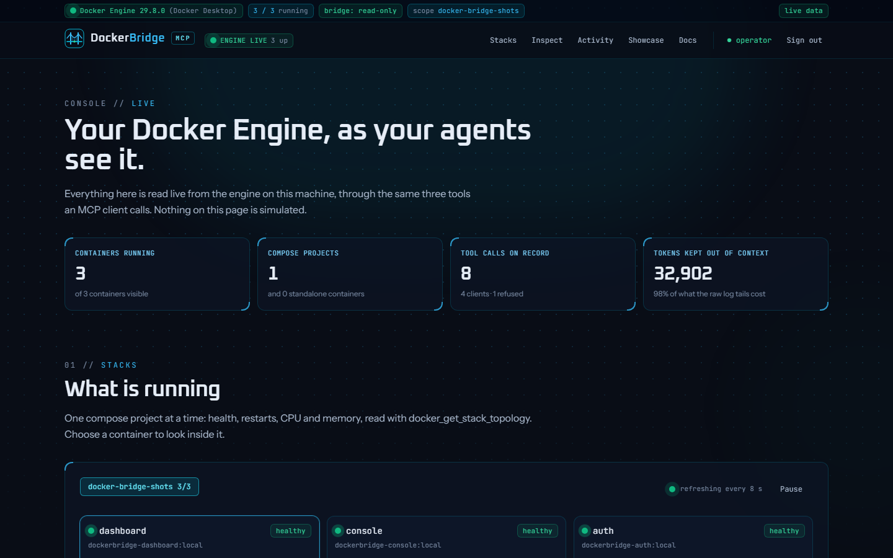
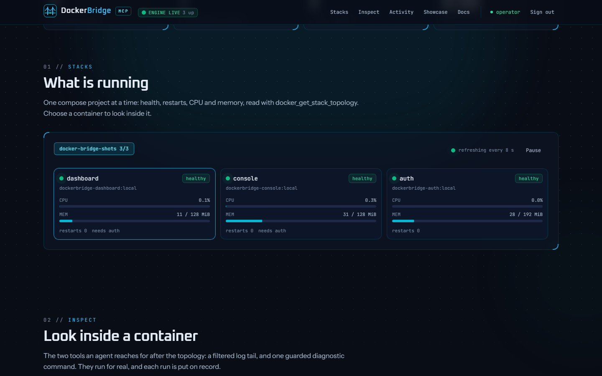
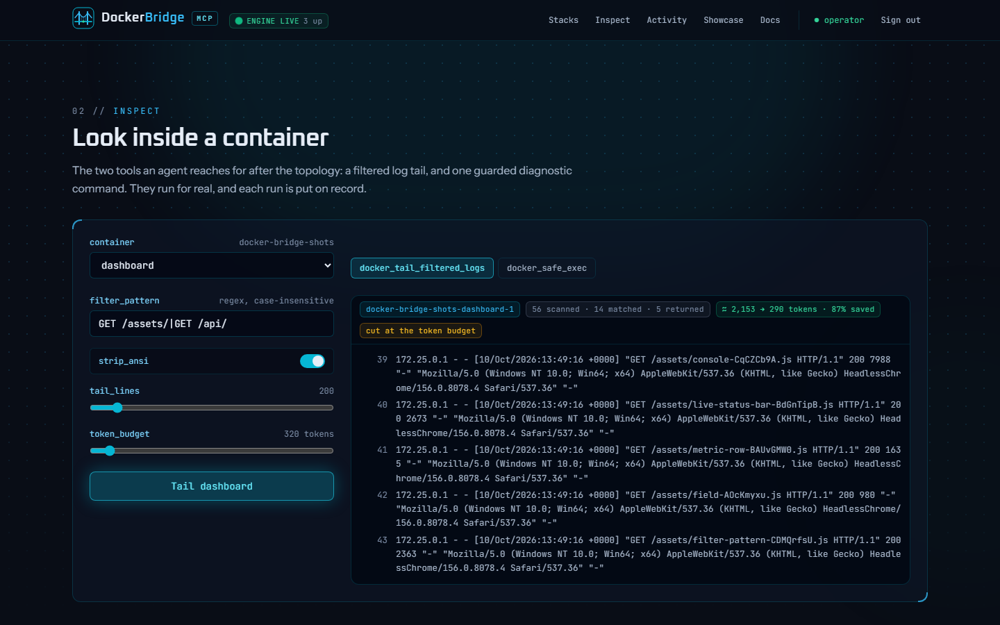
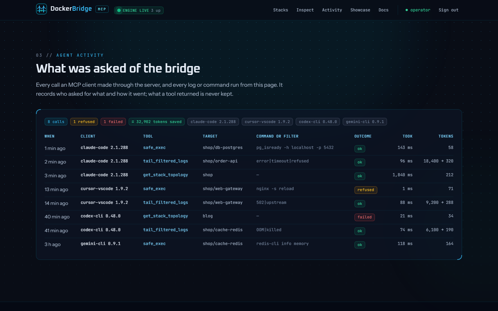
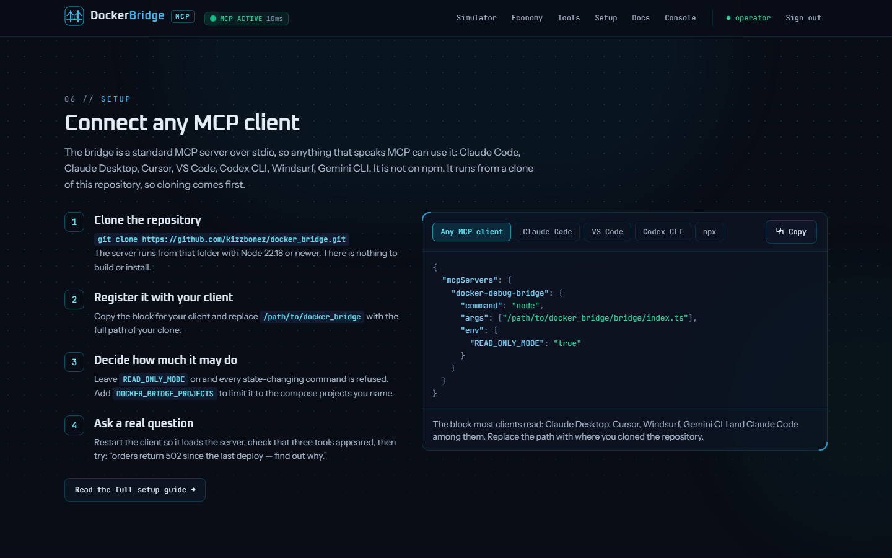
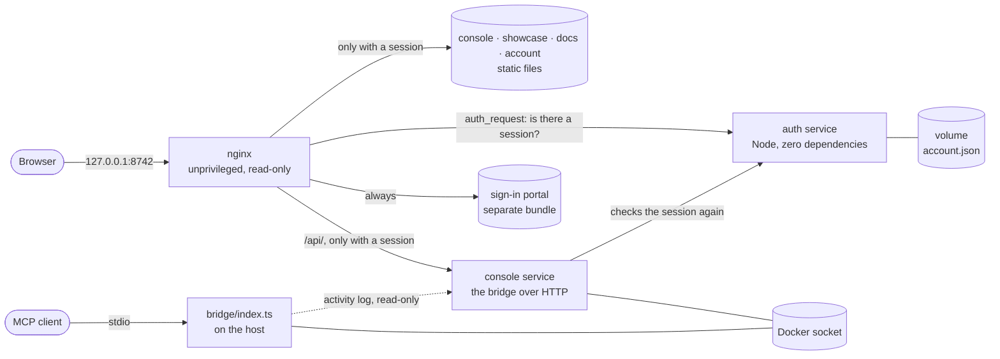

<p align="center">
  
</p>

<p align="center">
  <b>DockerBridge MCP</b><br>
  A Model Context Protocol server that lets any MCP client debug containers on your Docker Engine,<br>
  with a live console, an interactive showcase and documentation.
</p>

<p align="center">
  
  
  
  
  
  
  
</p>

<p align="center">
  <a href="#connect-an-mcp-client">Connect a client</a> ·
  <a href="#the-live-console">Live console</a> ·
  <a href="#what-is-inside">What is inside</a> ·
  <a href="#sign-in-and-onboarding">Sign-in</a> ·
  <a href="#architecture">Architecture</a> ·
  <a href="#testing">Testing</a> ·
  <a href="#security">Security</a> ·
  <a href="#versioning">Versioning</a> ·
  <a href="#license">License</a>
</p>

---

This repository holds three things:

- **The MCP server** (`bridge/`) — real. It talks to your local Docker Engine and gives an agent three tools.
- **The live console** — real. The page you land on after signing in: your engine, read through the same three
  tools, plus a record of what your agents asked for.
- **The showcase** — simulated. A guided walkthrough with fixture containers and logs, run through the server's own
  log pipeline and exec policy in the browser. It says so on the page.

## The MCP server

Three tools, built for an agent rather than a person at a terminal:

| Tool | What it returns |
|---|---|
| `docker_get_stack_topology` | One compact graph of a compose project: services, health, restarts, CPU and memory, dependency edges |
| `docker_tail_filtered_logs` | The tail of a log with ANSI stripped, filtered by regex, repeats collapsed, cut at a token budget |
| `docker_safe_exec` | The output of one allowlisted diagnostic command, run as argv with a deadline. Never a shell |

It is a standard MCP server over stdio, so it is not tied to one agent: Claude Code, Claude Desktop, Cursor,
VS Code, Codex CLI, Windsurf, Gemini CLI and anything else that speaks MCP can use it.

## Connect an MCP client

### 1. Clone the repository

The server is not on npm. It runs straight from source, from a clone on the same machine as your client, with
Node 22.18 or newer. There is nothing to build and it has no dependencies.

```bash
git clone https://github.com/kizzbonez/docker_bridge.git
cd docker_bridge
pwd        # the full path the next step asks for
```

### 2. Register it with your client

Most clients read the same `mcpServers` block. Replace the path with the full path of your clone (on Windows, use
forward slashes: `C:/Users/you/docker_bridge/bridge/index.ts`).

```json
{
  "mcpServers": {
    "docker-debug-bridge": {
      "command": "node",
      "args": ["/path/to/docker_bridge/bridge/index.ts"],
      "env": {
        "READ_ONLY_MODE": "true"
      }
    }
  }
}
```

| Client | Where the block goes |
|---|---|
| Claude Code | `~/.claude.json`, or `.mcp.json` at a project root. Or run the command below |
| Claude Desktop | `claude_desktop_config.json` (Settings → Developer → Edit Config) |
| Cursor | `~/.cursor/mcp.json`, or `.cursor/mcp.json` in a project |
| Windsurf | `~/.codeium/windsurf/mcp_config.json` |
| Gemini CLI | `~/.gemini/settings.json` |

<details>
<summary>Claude Code from a terminal, VS Code and Codex CLI</summary>

```bash
claude mcp add docker-debug-bridge --scope user \
  -e READ_ONLY_MODE=true \
  -- node /path/to/docker_bridge/bridge/index.ts
```

VS Code, in `.vscode/mcp.json`:

```json
{
  "servers": {
    "docker-debug-bridge": {
      "type": "stdio",
      "command": "node",
      "args": ["/path/to/docker_bridge/bridge/index.ts"],
      "env": { "READ_ONLY_MODE": "true" }
    }
  }
}
```

Codex CLI, in `~/.codex/config.toml`:

```toml
[mcp_servers.docker-debug-bridge]
command = "node"
args = ["/path/to/docker_bridge/bridge/index.ts"]

[mcp_servers.docker-debug-bridge.env]
READ_ONLY_MODE = "true"
```

</details>

### 3. Restart the client and ask

Clients load MCP servers when they start. After a restart the server should be listed with three tools. Then ask
something like *"orders return 502 since the last deploy, find out why"*.

| Variable | Default | Effect |
|---|---|---|
| `READ_ONLY_MODE` | on | `docker_safe_exec` refuses every state-changing command. Only `false`, `0`, `no` or `off` turns it off |
| `DOCKER_SOCKET_PATH` | `/var/run/docker.sock`, or `//./pipe/docker_engine` on Windows | The local engine to talk to. Remote engines are not supported |
| `DOCKER_BRIDGE_PROJECTS` | unset | Comma-separated compose projects. When set, no tool can see anything outside them |
| `DOCKER_BRIDGE_ACTIVITY` | on | The server records each tool call (not its output) in `data/activity/` for the console. `off` disables it |

**What it will not do.** There is no tool to start, stop, remove or create anything. Exec is limited to an
allowlist of diagnostic binaries, spawned as argv: pipes, redirects and chaining are refused, as are credential
files, non-local database connections and writing SQL. Output is redacted for secrets and clipped. It is a
guardrail, not a sandbox: the Docker socket is root-equivalent, so the container's own permissions remain the real
boundary.

## The live console

```bash
docker compose up -d --build
docker compose logs auth          # first start: prints the one-time setup token
```

Open **http://127.0.0.1:8742**, paste the token, and follow the onboarding wizard. You land on the console.

<table>
  <tr>
    <td width="50%"></td>
    <td width="50%"></td>
  </tr>
  <tr>
    <td align="center"><sub>The engine at a glance: every number is read live</sub></td>
    <td align="center"><sub>Each compose project, as <code>docker_get_stack_topology</code> reports it</sub></td>
  </tr>
  <tr>
    <td></td>
    <td></td>
  </tr>
  <tr>
    <td align="center"><sub>A real log through the filter, with the tokens it saved</sub></td>
    <td align="center"><sub>What each MCP client asked for, and how it went</sub></td>
  </tr>
</table>

- **Stacks.** Every compose project on the engine: health, restarts, CPU and memory per service, refreshed live.
- **Inspect.** `docker_tail_filtered_logs` and `docker_safe_exec` against a container you pick.
- **Activity.** Every call an MCP client made through the server, by client name, and every log or command run
  from the console. What a tool returned is never recorded.

The console runs the same code as the MCP server, so it shows exactly what an agent would be given. One container,
`console`, is given the Docker socket for this. It publishes no port, answers only a signed-in session, has no call
that changes a container, and refuses to run commands in its own stack. To run the site with no Docker access at
all (showcase and docs only):

```bash
docker compose up -d --build --scale console=0
```

| Setting (`.env`) | Default | Effect |
|---|---|---|
| `READ_ONLY_MODE` | `true` | The console refuses every state-changing command |
| `CONSOLE_EXEC` | `true` | `false`: no command can be run from the browser at all |
| `DOCKER_BRIDGE_PROJECTS` | unset | Limit the console to the compose projects you name |
| `DOCKER_SOCKET_GID` | `0` | The group that owns the socket. `0` suits Docker Desktop; on Linux use the `docker` group's gid |
| `FRAME_ANCESTORS` | `none` | Who may show the site in an `<iframe>`: `none`, or `self` and https origins separated by spaces, e.g. `https://portfolio.example.com`. Wildcards for everyone and http origins are refused |

The port is bound to `127.0.0.1`, so the site is reachable from this machine only. To publish it, keep that bind
and point a tunnel at it: with Cloudflare Tunnel, add a public hostname whose service is
`http://host.docker.internal:8742` (or `http://localhost:8742` if cloudflared runs on the host). Session cookies
become `Secure` automatically over HTTPS, and lockouts use the visitor address Cloudflare reports. Leave Rocket
Loader and automatic Web Analytics injection off for the hostname: the site's Content-Security-Policy refuses
injected scripts. Once published, anyone who can sign in can read container logs and run the allowlisted
diagnostics, so consider a second gate (such as Cloudflare Access) in front.

## What is inside

| | |
|---|---|
| **Live console** (`/`) | The engine on this machine: stacks, logs, guarded exec and agent activity. Real data. |
| **Showcase** (`/showcase/`) | A simulated walkthrough: an agent debugging a broken stack, the token economy of filtered logs, a tool playground, and the setup guide. |
| **Documentation** (`/docs/`) | Setup for any MCP client, tool tables, sample payloads and guardrail rules, rendered from the same schemas and policy the server runs, so they cannot drift. |
| **Account & security** (`/account/`) | Sessions, password and recovery-code rotation, recent security activity. |
| **Sign-in wall** | Every page, asset and API call sits behind password + authenticator sign-in. A first-run wizard creates the account. |

<table>
  <tr>
    <td width="50%"></td>
    <td width="50%"></td>
  </tr>
  <tr>
    <td align="center"><sub>Showcase: hero and animated counters</sub></td>
    <td align="center"><sub>Showcase: the mesh alarms while the agent diagnoses a Redis OOM</sub></td>
  </tr>
  <tr>
    <td></td>
    <td></td>
  </tr>
  <tr>
    <td align="center"><sub>Showcase: raw logs against the filtered tool output</sub></td>
    <td align="center"><sub>Setup for any MCP client, starting with the clone</sub></td>
  </tr>
  <tr>
    <td></td>
    <td></td>
  </tr>
  <tr>
    <td align="center"><sub>First-run onboarding: enrolling an authenticator</sub></td>
    <td align="center"><sub>Sessions, credentials and security activity</sub></td>
  </tr>
  <tr>
    <td></td>
    <td></td>
  </tr>
  <tr>
    <td align="center"><sub>Documentation generated from the tool schemas</sub></td>
    <td align="center"><sub>The sign-in portal: the only public page</sub></td>
  </tr>
</table>

## Sign-in and onboarding

Nothing is public. A fresh install has no account, so the first visit opens a four-step wizard:

1. **Verify** — paste the one-time setup token from `docker compose logs auth`. It proves you control the server, so
   nobody else can claim a new install.
2. **Account** — choose the administrator's username and a password of at least 12 characters, against a live checklist.
3. **Authenticator** — scan the QR code with any TOTP app and confirm with a code. Two-factor is not optional.
4. **Recovery** — save ten single-use recovery codes. They are shown once.

After that, sign-in is two steps: password, then an authenticator or recovery code.
**Account & security** (`/account/`) lists every active session, rotates the password and recovery codes, and shows
recent security activity.

| Control | How it works |
|---|---|
| Password storage | scrypt (N=2^15, r=8, p=3), per-password salt; only the hash is stored |
| Second factor | TOTP (RFC 6238); each code is accepted once, with ±30 s of clock drift |
| Brute force | 5 failures lock that client + account for 15 minutes; 5 guesses per sign-in challenge |
| Sessions | 256-bit token in an `HttpOnly`, `SameSite=Strict` cookie; 12 h lifetime, 2 h idle timeout; revocable |
| Cross-site requests | State-changing calls require JSON and are refused when the browser reports another origin |
| Sensitive changes | A new password or new recovery codes need a fresh authenticator code |
| Audit trail | Sign-ins, failures, lockouts and changes, as JSON lines in the container log and on the account page |

Lost the authenticator **and** the recovery codes? Reset from the host, which is deliberately the only way:

```bash
npm run auth:reset     # deletes the account; a new setup token is printed on restart
```

## Architecture



- **Three containers.** `dashboard` is nginx serving static files; `auth` is a small Node service that nginx
  consults before serving anything; `console` is the bridge's tools over HTTP. `auth` and `console` have no npm
  dependencies, publish no port, and sit on an internal network with no route to the internet.
- **One socket holder.** Only `console` is given the Docker socket. The MCP server itself runs on the host, started
  by your client, and writes a record of its calls that the console reads through a read-only mount.
- **Two bundles.** The sign-in portal is built separately, so no page, image or document is reachable without a
  session.
- **One source of truth.** The tool schemas, exec policy, regex guard and log pipeline live in `bridge/core`. The
  MCP server and the console enforce them; the showcase and the docs import the same files, so what the site shows
  is what the server does.

```
docker_bridge/
├─ index.html                      the live console            ┐
├─ showcase/ · docs/ · account/    showcase, docs, account     ┘ protected pages
├─ portal/                         sign-in + onboarding (the only public bundle)
├─ bridge/                         the MCP server
│  ├─ core/                        tool schemas, exec policy, log pipeline (shared with the site)
│  ├─ docker/                      Engine API client over socket or named pipe
│  ├─ tools/ · mcp/ · activity/    the three tools, the stdio protocol, the call log
├─ console/                        the console's API: the bridge's tools over HTTP
├─ auth/                           sign-in service: TOTP, sessions, lockout, audit log
├─ data/activity/                  the MCP server's record of tool calls (git-ignored)
├─ src/
│  ├─ features/                    one folder per section: model/ + ui/
│  ├─ mock-bridge/                 the simulation: fixtures fed through bridge/core
│  ├─ shared/                      ui primitives, hooks, lib
│  └─ styles/                      design tokens and component layers
├─ docker/nginx/                   server config, security headers
├─ tests/e2e/                      Playwright specs
└─ security/                       secsuite targets and scan reports
```

Files stay small on purpose: ESLint fails the build above 200 lines per file or 40 lines per function.

## Development

```bash
npm install
npm run dev            # Vite on 127.0.0.1:5173 (no sign-in wall in dev)
npm run console        # second terminal: live data for the console page
```

| Script | What it does |
|---|---|
| `npm run verify` | Typecheck, lint with size budgets, unit tests and a production build |
| `npm run test` | Vitest: 389 unit and component tests, including the three services over real HTTP and stdio |
| `npm run e2e` | Starts a throwaway stack, walks through onboarding, then runs 160 browser tests |
| `npm run bridge` | The MCP server on stdio, as a client would launch it |
| `npm run console` | The console API from source, for the dev server. No sign-in: never publish its port |
| `npm run screenshots` | Regenerates the images above on a throwaway stack |
| `npm run load-check` | Starts a throwaway stack and prints how the whole chain answers with 1, 6 and 12 pages polling at once |
| `npm run brand` | Re-renders the PNG logo exports from the SVG mark |
| `npm run auth:status` / `auth:reset` | Inspect or delete the administrator account |

## Testing

- **Unit and component (Vitest)** — the exec policy and its bypass attempts, the log pipeline, the activity log,
  the simulator's playback reducer, every widget and console panel, and the auth service end to end over HTTP:
  RFC 6238 test vectors, replay protection, lockout, session expiry, CSRF and request hygiene.
- **The MCP server and the console service** — the Engine client is driven against a fake Docker Engine listening
  on a real pipe; the MCP server is run as a child process and spoken to over stdio, the way a client does; the
  console service is run over real HTTP, including what it refuses.
- **End to end (Playwright)** — against the real containers and a real Docker Engine, at desktop and phone sizes:
  onboarding through the UI, two-factor sign-in, lockout, account changes, the live console reading real
  containers, every showcase interaction, WCAG A/AA checks with axe on every page, and the response headers.
  Every test fails on a console error, which includes any CSP violation.

The e2e and screenshot runs use their own compose project, port and volume, and their console is limited to that
throwaway project, so they never touch or reveal a real install.

## Security

- **Headers.** A Content-Security-Policy of `default-src 'none'` with first-party files only (no inline script or
  style, no third-party origin), plus `nosniff`, `Referrer-Policy: no-referrer`, COOP, CORP and a locked-down
  Permissions-Policy. No page may frame the site unless you name it in `FRAME_ANCESTORS`. Protected responses are `Cache-Control: private`, so a CDN in front
  cannot cache and replay them.
- **Containers.** Unprivileged users, read-only root filesystems, all capabilities dropped, `no-new-privileges`,
  memory, CPU and PID limits, base images pinned by digest.
- **The Docker socket.** Mounted in the `console` container only. That service is reachable only through nginx
  with a session, checks the session again itself, accepts `POST` on one endpoint as same-site JSON, and writes
  an audit line for every log read or command run. See [`security/reports/SUMMARY.md`](security/reports/SUMMARY.md)
  for how this is weighed.
- **Scans.** Run with the local secsuite stack; targets are in [`security/secsuite/targets.yml`](security/secsuite/targets.yml)
  and results in [`security/reports`](security/reports).

## Versioning

This project follows [Semantic Versioning](https://semver.org) and [Conventional Commits](https://www.conventionalcommits.org).
Each release is a git tag (`vMAJOR.MINOR.PATCH`) with an entry in [CHANGELOG.md](CHANGELOG.md).

## License

[MIT](LICENSE). You may use, change and redistribute this, including commercially, as long as the copyright and
licence notice stay with it. It comes with no warranty.

The fonts and libraries bundled into the built site keep their own licences: see
[THIRD_PARTY_NOTICES.md](THIRD_PARTY_NOTICES.md).
