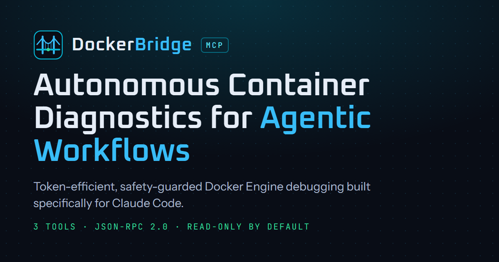
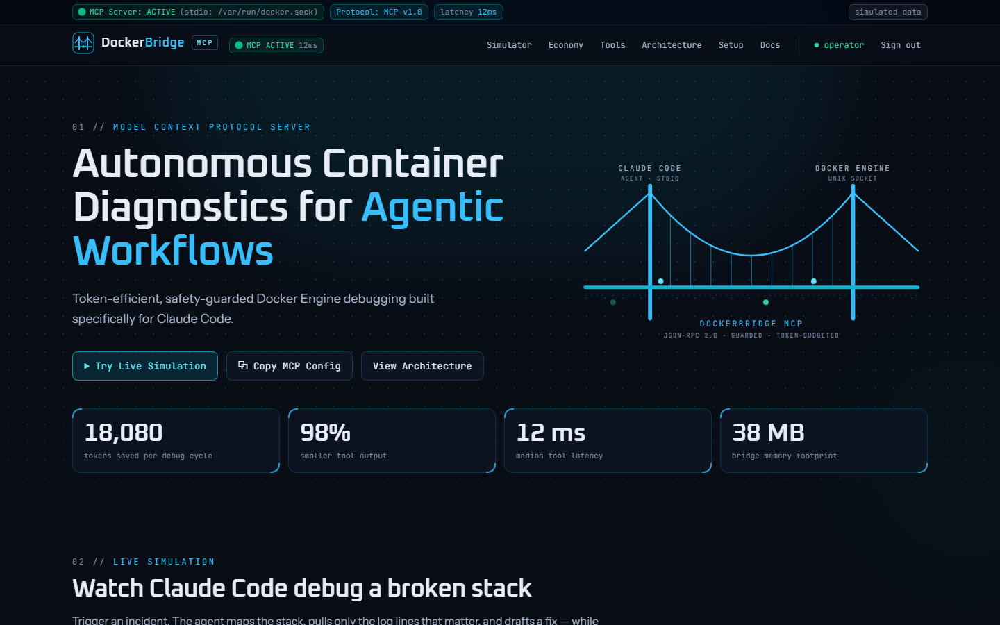
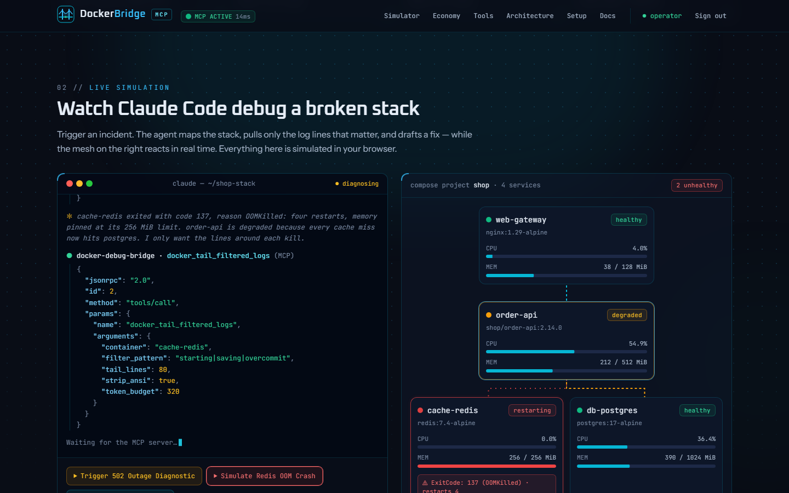
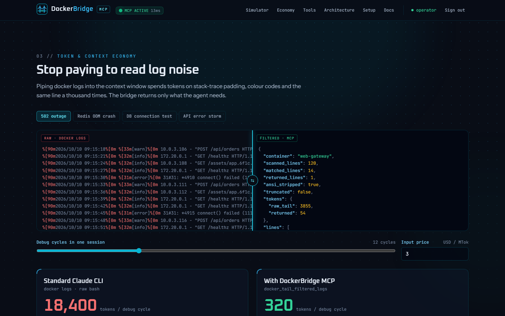
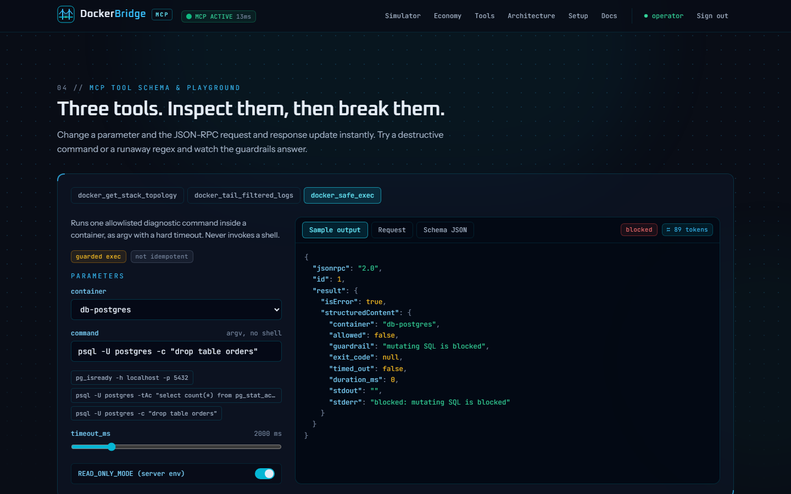
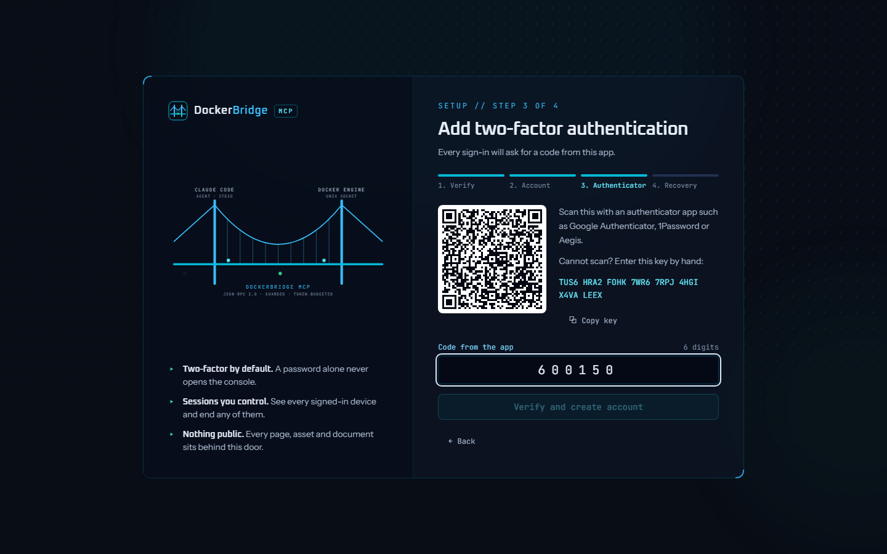
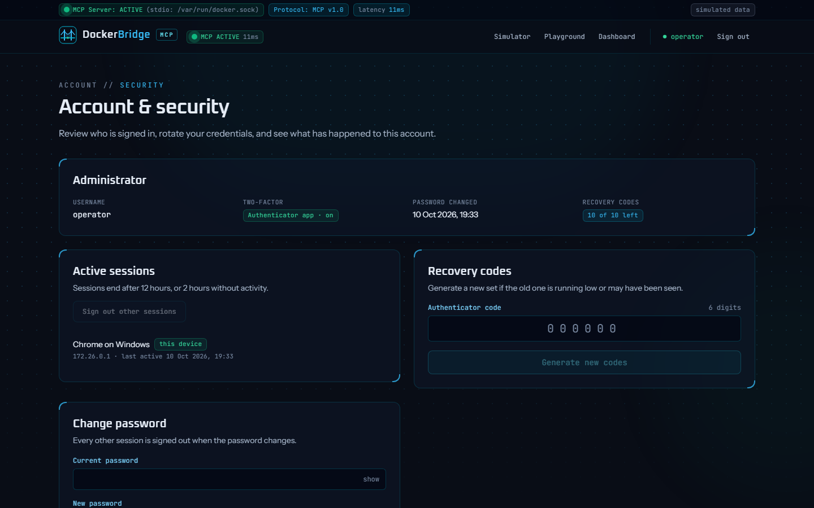
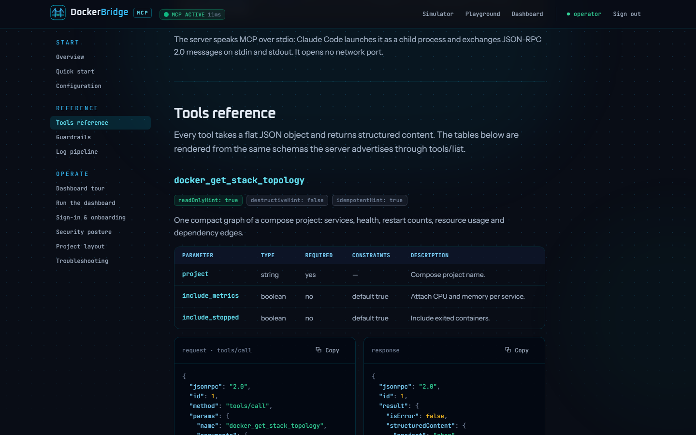
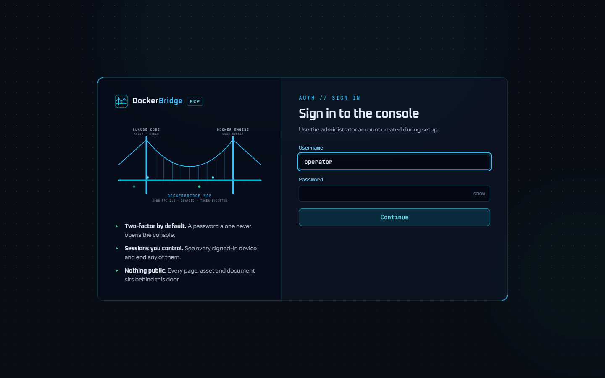
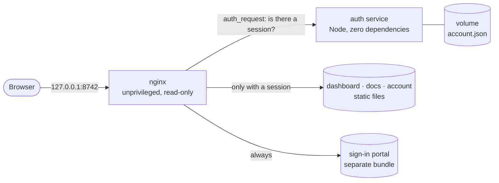

<p align="center">
  
</p>

<p align="center">
  <b>The interactive dashboard and documentation for DockerBridge MCP</b><br>
  a Model Context Protocol server that bridges Claude Code to the Docker Engine for live container debugging.
</p>

<p align="center">
  
  
  
  
  
</p>

<p align="center">
  <a href="#quick-start">Quick start</a> ·
  <a href="#what-is-inside">What is inside</a> ·
  <a href="#sign-in-and-onboarding">Sign-in</a> ·
  <a href="#architecture">Architecture</a> ·
  <a href="#testing">Testing</a> ·
  <a href="#security">Security</a> ·
  <a href="#versioning">Versioning</a>
</p>

---

> [!NOTE]
> **This site is a showcase.** The container stack, logs, metrics and tool responses are simulated in the browser
> by a mock of the server contract. Nothing here mounts or contacts a Docker socket. The package name
> `@your-handle/docker-debug-mcp` in the configuration samples is a placeholder for your own published server.

## Quick start

```bash
docker compose up -d --build
docker compose logs auth          # first start: prints the one-time setup token
```

Open **http://127.0.0.1:8742**, paste the token, and follow the onboarding wizard. That is the whole install.

The port is bound to `127.0.0.1`, so the site is reachable from this machine only. To publish it, put a reverse
proxy or tunnel in front; do not change the bind address.

## What is inside

| | |
|---|---|
| **Live debugging simulator** | A Claude Code terminal streams the agent's reasoning, the exact JSON-RPC tool calls and the proposed diff, while a container mesh reacts beside it. Trigger a 502 outage, a Redis OOM kill (`ExitCode: 137 (OOMKilled)`) or a database connection test. |
| **Token & context economy** | A draggable before/after view of raw `docker logs` against the filtered result, with cost and context-window pressure recomputed from a CSV dataset you can download. |
| **MCP tool playground** | Change any parameter of the three tools and watch the request and response update. Try a destructive command or a runaway regex and read the guardrail's answer. |
| **Documentation** | A full docs page whose tool tables, sample payloads and guardrail rules are rendered from the same schemas and policy the playground runs, so they cannot drift. |
| **Sign-in wall** | Every page, asset and document sits behind password + authenticator sign-in. A first-run wizard creates the account. |

<table>
  <tr>
    <td width="50%"></td>
    <td width="50%"></td>
  </tr>
  <tr>
    <td align="center"><sub>Status bar, hero and animated counters</sub></td>
    <td align="center"><sub>Redis OOM: the mesh alarms while the agent diagnoses</sub></td>
  </tr>
  <tr>
    <td></td>
    <td></td>
  </tr>
  <tr>
    <td align="center"><sub>Raw logs against the filtered tool output</sub></td>
    <td align="center"><sub>A destructive command, refused with a reason</sub></td>
  </tr>
  <tr>
    <td></td>
    <td></td>
  </tr>
  <tr>
    <td align="center"><sub>First-run onboarding: enrolling an authenticator</sub></td>
    <td align="center"><sub>Sessions, credentials and security activity</sub></td>
  </tr>
  <tr>
    <td></td>
    <td></td>
  </tr>
  <tr>
    <td align="center"><sub>Documentation generated from the tool schemas</sub></td>
    <td align="center"><sub>The sign-in portal: the only public page</sub></td>
  </tr>
</table>

## Sign-in and onboarding

Nothing is public. A fresh install has no account, so the first visit opens a four-step wizard:

1. **Verify** — paste the one-time setup token from `docker compose logs auth`. It proves you control the server, so
   nobody else can claim a new install.
2. **Account** — choose the administrator's username and a password of at least 12 characters, against a live checklist.
3. **Authenticator** — scan the QR code with any TOTP app and confirm with a code. Two-factor is not optional.
4. **Recovery** — save ten single-use recovery codes. They are shown once.

After that, sign-in is two steps: password, then an authenticator or recovery code.
**Account & security** (`/account/`) lists every active session, rotates the password and recovery codes, and shows
recent security activity.

| Control | How it works |
|---|---|
| Password storage | scrypt (N=2^15, r=8, p=3), per-password salt; only the hash is stored |
| Second factor | TOTP (RFC 6238); each code is accepted once, with ±30 s of clock drift |
| Brute force | 5 failures lock that client + account for 15 minutes; 5 guesses per sign-in challenge |
| Sessions | 256-bit token in an `HttpOnly`, `SameSite=Strict` cookie; 12 h lifetime, 2 h idle timeout; revocable |
| Cross-site requests | State-changing calls require JSON and are refused when the browser reports another origin |
| Sensitive changes | A new password or new recovery codes need a fresh authenticator code |
| Audit trail | Sign-ins, failures, lockouts and changes, as JSON lines in the container log and on the account page |

Lost the authenticator **and** the recovery codes? Reset from the host, which is deliberately the only way:

```bash
npm run auth:reset     # deletes the account; a new setup token is printed on restart
```

## Architecture



- **Two containers.** `dashboard` is nginx serving static files; `auth` is a small Node service with no npm
  dependencies that nginx consults before serving anything. `auth` publishes no port and sits on an internal
  network with no route to the internet.
- **Two bundles.** The sign-in portal is built separately, so no dashboard code, image or document is reachable
  without a session.
- **One source of truth.** The simulator, the playground and the docs call the same mock tools
  (`src/mock-bridge`), and the browser imports the password policy from the auth service's own module.

```
docker_bridge/
├─ index.html · docs/ · account/   protected pages
├─ portal/                         sign-in + onboarding (the only public bundle)
├─ auth/                           sign-in service: TOTP, sessions, lockout, audit log
├─ src/
│  ├─ features/                    one folder per section: model/ + ui/
│  ├─ mock-bridge/                 the simulated MCP server (pure TypeScript)
│  ├─ shared/                      ui primitives, hooks, lib
│  └─ styles/                      design tokens and component layers
├─ docker/nginx/                   server config, security headers
├─ tests/e2e/                      Playwright specs
└─ security/                       secsuite targets and scan reports
```

Files stay small on purpose: ESLint fails the build above 200 lines per file or 40 lines per function.

## Development

```bash
npm install
npm run dev            # Vite on 127.0.0.1:5173 (no sign-in wall in dev)
```

| Script | What it does |
|---|---|
| `npm run verify` | Typecheck, lint with size budgets, unit tests and a production build |
| `npm run test` | Vitest: 237 unit and component tests, including the auth service over real HTTP |
| `npm run e2e` | Starts a throwaway stack, walks through onboarding, then runs 121 browser tests |
| `npm run screenshots` | Regenerates the images above on a throwaway stack |
| `npm run brand` | Re-renders the PNG logo exports from the SVG mark |
| `npm run auth:status` / `auth:reset` | Inspect or delete the administrator account |

## Testing

- **Unit and component (Vitest)** — the mock MCP tools and guardrails, the simulator's playback reducer, every
  widget, and the auth service end to end over HTTP: RFC 6238 test vectors, replay protection, lockout, session
  expiry, CSRF and request hygiene.
- **End to end (Playwright)** — against the real containers, at desktop and phone sizes: onboarding through the UI,
  two-factor sign-in, lockout, account changes, every dashboard interaction, WCAG A/AA checks with axe on every
  page, and the response headers. Every test fails on a console error, which includes any CSP violation.

The e2e and screenshot runs use their own compose project, port and volume, so they never touch a real install.

## Security

- **Headers.** A Content-Security-Policy of `default-src 'none'` with first-party files only (no inline script or
  style, no third-party origin), plus `nosniff`, `X-Frame-Options: DENY`, `Referrer-Policy: no-referrer`, COOP,
  CORP and a locked-down Permissions-Policy. Protected responses are `Cache-Control: private`, so a CDN in front
  cannot cache and replay them.
- **Containers.** Unprivileged users, read-only root filesystems, all capabilities dropped, `no-new-privileges`,
  memory, CPU and PID limits, base images pinned by digest.
- **Scans.** Run with the local secsuite stack; targets are in [`security/secsuite/targets.yml`](security/secsuite/targets.yml)
  and results in [`security/reports`](security/reports).

## Versioning

This project follows [Semantic Versioning](https://semver.org) and [Conventional Commits](https://www.conventionalcommits.org).
Each release is a git tag (`vMAJOR.MINOR.PATCH`) with an entry in [CHANGELOG.md](CHANGELOG.md).

## Using the real server with Claude Code

The dashboard's setup section and the docs explain how an MCP server like this is registered. In short:

```bash
claude mcp add docker-debug-bridge \
  -e DOCKER_SOCKET_PATH=/var/run/docker.sock \
  -e READ_ONLY_MODE=false \
  -- npx -y @your-handle/docker-debug-mcp
```

The Docker socket is root-equivalent. Start with `READ_ONLY_MODE=true`.
